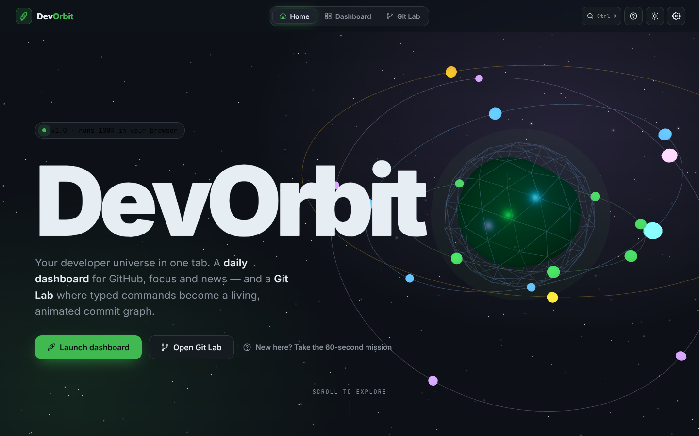
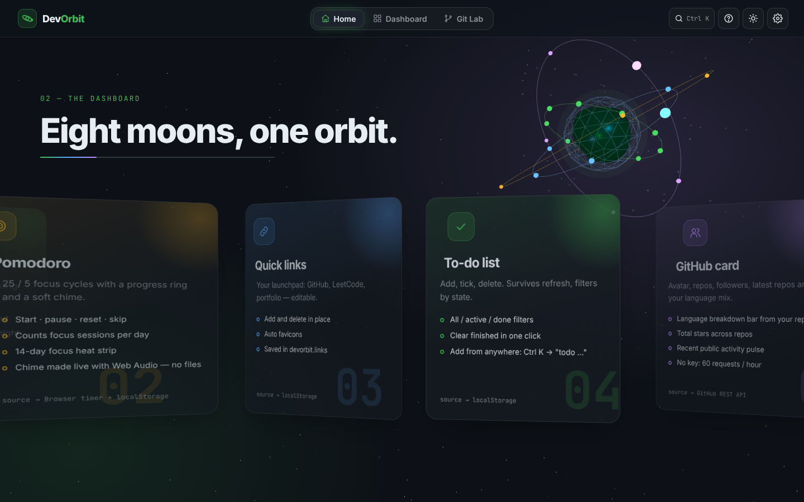
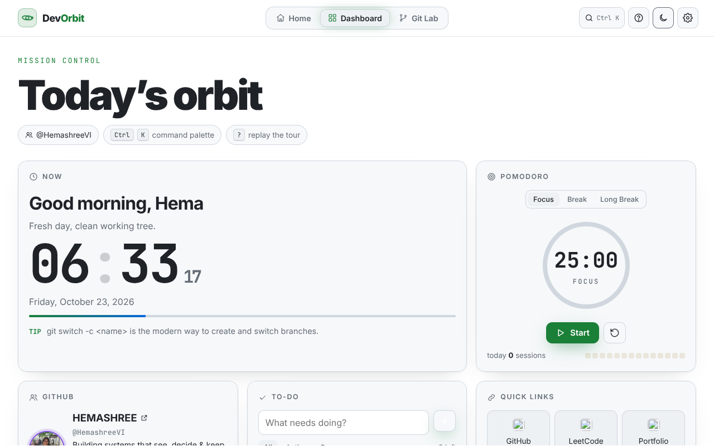
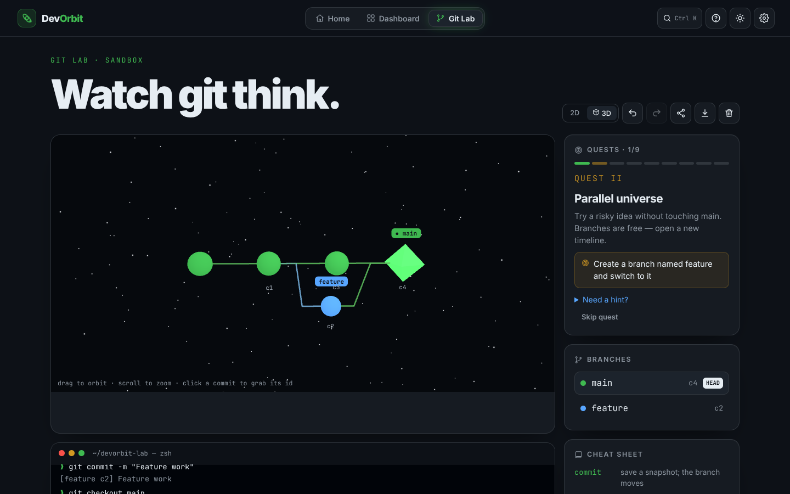
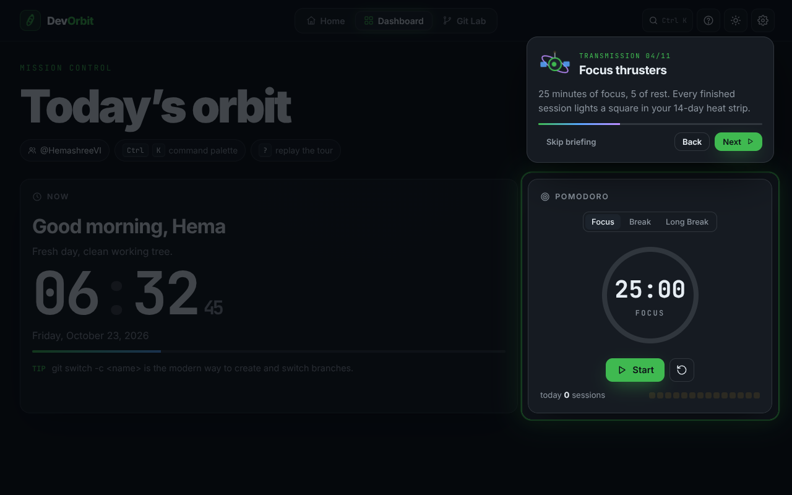

# DevOrbit 🪐

**Your developer universe in one tab.** A daily dashboard for GitHub, focus and tech news, plus a **Git Lab** that turns typed git commands into a living, animated commit graph in 2D or 3D.

**Live:** https://hemashreevi.github.io/devorbit/



Everything runs in the browser. There's no backend, you don't need any API keys, and it deploys free on GitHub Pages.

---

## Three worlds

| | |
|---|---|
| **Home**: a cinematic, scroll-driven story. A 3D planet (React Three Fiber) travels between sections, feature "moons" slide past on a curved 3D carousel, and a pinned scrollytelling section explains git in five ideas. |  |
| **Dashboard**: the page you open every day. Greeting and clock, a Pomodoro with a 14-day focus heat strip, a GitHub card with language mix and an activity pulse, a to-do list, quick links, the Hacker News top 10, a scratchpad and LeetCode stats. |  |
| **Git Lab**: type real commands and watch commits slide in, branch labels glide and merge commits burst. You can flip to a **3D orbit view**, and **9 guided quests** teach branching from zero. |  |

### "How to use" without a manual: the Mission Briefing
First-time visitors meet **ORBI**, a little navigation satellite. ORBI asks your name and GitHub username, then flies a spotlight across the *real* UI (dashboard, terminal, quests, command palette) in 11 short "transmissions". Press <kbd>?</kbd> any time to replay it.



## Features

**Dashboard**
- Greeting that changes with the hour, a live clock, a day-progress bar and a daily git tip
- Pomodoro (focus, break and long break) with a progress ring, a Web Audio chime, a session counter and a 14-day heat strip; the tab title shows the countdown
- To-do list with filters, animated add and delete, and "clear finished"
- Editable quick links with auto favicons
- GitHub card: avatar, repos, followers, total stars, a **language breakdown bar**, latest repos and an **activity pulse** (public REST API, no key)
- Hacker News top 10 with score, comments, domain and age
- Scratchpad that autosaves, and optional LeetCode stats (community API, fails gracefully)
- Light and dark themes, saved in `localStorage`

**Git Lab**
- `commit` (`-m`, `--amend`), `branch` (list, create, `-d`), `checkout` / `switch` (`-b` / `-c`, detached HEAD), `merge` (fast-forward, `--no-ff`, merge commits), `rebase`, `cherry-pick`, `reset --hard` (supports `HEAD~n`), `tag`, `log`, `status`, `help`
- Plain-English explanation of every command
- Undo and redo, a **share link** (the whole repo encoded in the URL), **export as SVG**, and a 2D/3D toggle
- Terminal with history (↑/↓) and Tab completion for commands, branches and commit ids
- Click any commit to drop its id into the terminal
- 9 quests: Liftoff → Parallel universe → Diverge → Rendezvous → Fast lane → Time machine → Straight line → Copy & paste → Ship it

**Everywhere**
- <kbd>Ctrl</kbd>/<kbd>⌘</kbd> + <kbd>K</kbd> command palette: navigate, start the timer, `todo buy milk`, `git commit -m "x"` or open a URL
- <kbd>1</kbd> <kbd>2</kbd> <kbd>3</kbd> switch worlds with a circular "warp" transition
- Lenis smooth scrolling synced with GSAP ScrollTrigger
- Respects `prefers-reduced-motion`; keyboard and focus friendly

## Tech stack

| Need | Choice |
|---|---|
| UI | React 19 + Vite |
| Animation | [GSAP](https://gsap.com) + ScrollTrigger + SplitText, using `useGSAP` (patterns from [greensock/gsap-skills](https://github.com/greensock/gsap-skills)) |
| Smooth scroll | [Lenis](https://github.com/darkroomengineering/lenis), driven by GSAP's ticker |
| 3D | three.js + React Three Fiber + drei |
| Components | [React Bits](https://github.com/DavidHDev/react-bits): SplitText, ShinyText, GradientText, ScrollReveal, DecryptedText, CountUp, SpotlightCard, Magnet, ClickSpark |
| Graph | Hand-written SVG + GSAP |
| Storage | `localStorage` via a `useLocalStorage` hook (`devorbit.*` keys) |
| Hosting | GitHub Pages (Actions workflow, or `npm run deploy`) |

## How `gitEngine.js` works

The git brain is a **pure function** that knows nothing about React:

```js
run(state, 'git merge feature') // → { state, output, explanation, effect } | { error }
```

A whole repo is one small object:

```js
{
  commits: { c0: { id: 'c0', parents: [], message: 'Initial commit', lane: 0, gen: 0 } },
  branches: { main: 'c0' },   // branch → commit id
  tags: {},
  HEAD: 'main',               // a branch name, or a commit id when detached
}
```

- **commit** adds `cN` with the current commit as its parent, then moves the branch HEAD points to.
- **merge X** fast-forwards if your commit is an ancestor of X; otherwise it creates a commit with two parents.
- **rebase X** walks back to the merge base, replays those commits on top of X as new ids, and leaves the originals orphaned (drawn faded).
- **Layout:** x = generation (parent's x + 1) and y = the lane of the branch it was made on.

Because every command returns a new state, undo/redo is just a history stack, and the engine is unit-tested with `node --test`.

## Run locally

```bash
npm install
npm run dev     # http://localhost:5173/devorbit/
npm test        # gitEngine unit tests
npm run build
```

## Deploy

**Option A: GitHub Actions (recommended).** Push to `main`, then go to *Settings → Pages → Source → GitHub Actions*. `.github/workflows/deploy.yml` tests, builds and publishes.

**Option B: one command.** `npm run deploy` (uses `gh-pages`), then set *Settings → Pages → Branch* to `gh-pages`.

`vite.config.js` uses `base: '/devorbit/'`. Change it if you rename the repo.

## Project structure

```
src/
  App.jsx               shell, view switching (warp transition), shortcuts
  components/           Header, Tour (ORBI), CommandPalette, Settings, Modal, Icon
  home/                 Home (scroll story), GitStory (pinned scrollytelling)
  three/OrbitScene.jsx  the 3D planet that travels with your scroll
  dashboard/            widgets + useFetch (cached API calls)
  gitviz/               gitEngine.js, quests.js, CommitGraph (SVG), Graph3D, CommandInput
  bits/                 React Bits components (see bits/README.md)
  hooks/                useLocalStorage, useLenis
tests/gitEngine.test.js
```

## Resume bullet

> Built **DevOrbit**, a React + Vite developer home page with an interactive Git visualizer that simulates commit, branch, checkout, merge, rebase, cherry-pick and reset through a pure, unit-tested state engine rendered as an animated SVG / 3D (React Three Fiber) graph. Added a GSAP + Lenis scroll-driven landing experience and a guided onboarding tour, integrated the GitHub and Hacker News APIs, and deployed it on GitHub Pages.

---

React Bits components © David Haz (MIT + Commons Clause), used as part of this app. Built by Hema.
